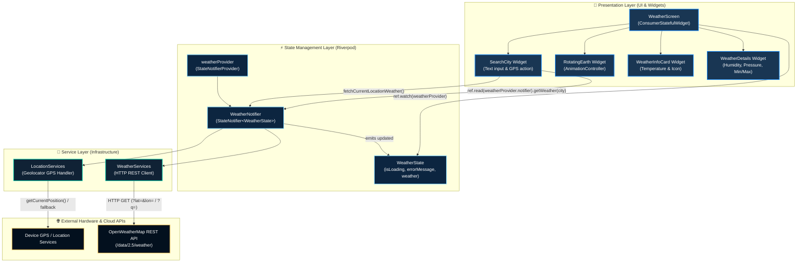

# 🌍 Mausamie- Real-Time Weather Application

<p align="center">
  
</p>

<p align="center">
  <em>"Your little window to the sky."</em>
</p>

<p align="center">
  
  
  
  
  
  
</p>

---

## 📖 Overview

**Mausamie** is a sleek, modern, and reactive cross-platform weather application crafted with **Flutter** and powered by **Riverpod** state management. Designed with a celestial deep-space aesthetic and smooth animations, Mausamie delivers real-time meteorological conditions for your current location upon launch and enables instant weather lookup for any city worldwide.

---

## 📲 Download APK An Android APK download will be available here when a release is published. **[Download Mausamie APK](https://github.com/Gaurav-0301/Mausamie/releases)** Visit the Releases page to check for an available build.


## ✨ Features

- 📍 **Automatic Location Detection**: Automatically acquires device GPS coordinates on startup via `geolocator` and loads hyper-local real-time weather instantly.
- 🔍 **Instant City Search**: Query any city or metropolitan area worldwide with live input handling and error resiliency.
- 🌐 **Interactive Celestial Visuals**: Featuring an ambient 3D rotating earth sphere powered by Flutter's `AnimationController` and matrix rotation transforms.
- 📊 **Comprehensive Weather Metrics**:
  - **Temperature**: Current temperature (°C) and condition description.
  - **Feels Like**: Apparent temperature accounting for humidity and wind chill.
  - **Humidity**: Relative atmospheric moisture percentage (`%`).
  - **Atmospheric Pressure**: Real-time barometric pressure reading (`hPa`).
  - **Min / Max Range**: Daily low and high temperature extremes.
- 🎨 **Cosmic Glassmorphic UI**: High-contrast, accessibility-focused deep space color palette (`#041225` to `#123D70`) with subtle frosted glass cards and glow shadows.
- 📱 **Adaptive & Responsive Layout**: Fluidly scales across all screen factors—from compact smartphones to large tablets.
- 🚀 **Native Branding & Splash**: Fully configured with adaptive launcher icons for Android 12+ / iOS and native dark splash screens.

---

## 🏛️ Architecture & System Design

Mausamie adopts **Clean Architecture** principles and **Unidirectional Data Flow (UDF)** powered by **Flutter Riverpod**. Separation of concerns guarantees maintainability, modularity, and testability.

### High-Level Architecture Diagram



---


## 📂 Project Directory Structure

```plaintext
mausamie/
├── android/                             # Android native configuration & manifests
│   └── app/src/main/AndroidManifest.xml # Permissions (INTERNET, ACCESS_FINE_LOCATION)
├── assets/
│   ├── icon/
│   │   ├── app_icon.png                 # Master application icon
│   │   ├── app_icon_foreground.png      # Android adaptive icon foreground layer
│   │   └── splash_logo.png              # High-resolution splash logo
│   └── images/
│       └── earth.png                    # Texture used for continuous rotating earth
├── ios/
│   └── Runner/Info.plist                # iOS location usage description permissions
├── lib/
│   ├── components/                      # Reusable UI component widgets
│   │   ├── RotatingEarth.dart           # Smooth 60s rotational animation of planet Earth
│   │   ├── SearchCity.dart              # Custom search bar with GPS trigger button
│   │   ├── WeatherDetails.dart          # 4-metric grid (Feels like, Humidity, Pressure, Min/Max)
│   │   └── WeatherInfoCard.dart         # Hero card displaying temperature, location, and condition icon
│   ├── models/                          # Immutable Domain Data Models
│   │   ├── MainWeatherData.dart         # Temperature, feels_like, pressure, humidity
│   │   ├── WeatherCondition.dart        # Weather classification and description text
│   │   ├── WeatherModel.dart            # Unified weather aggregate entity with coord lat/lon
│   │   └── WeatherState.dart            # Riverpod view state (isLoading, errorMessage, weather)
│   ├── providers/                       # State management logic
│   │   └── Weather_provider.dart        # WeatherNotifier with coordinate & city query actions
│   ├── screens/                         # Application screens
│   │   └── WeatherScreen.dart           # Main responsive weather dashboard
│   ├── services/                        # Infrastructure & Network services
│   │   ├── Location_Services.dart       # Geolocator permission handling and GPS position polling
│   │   └── Weather_Services.dart        # OpenWeatherMap REST API client
│   ├── app.dart                         # MausamieApp root MaterialApp configuration
│   └── main.dart                        # Application entry point with ProviderScope
├── test/
│   └── widget_test.dart                 # Automated widget smoke test suite
├── pubspec.yaml                         # Project dependencies and asset definitions
└── README.md                            # Complete project documentation
```

---

## 🛠️ Tech Stack & Dependencies

| Category | Technology | Purpose |
| :--- | :--- | :--- |
| **Framework** | [Flutter](https://flutter.dev) (v3.13+) | Multi-platform declarative UI toolkit |
| **Language** | [Dart](https://dart.dev) (v3.0+) | Strongly-typed, sound null-safe programming language |
| **State Management** | [flutter_riverpod](https://pub.dev/packages/flutter_riverpod) (^3.4.3) | Reactive, compile-safe state management |
| **Location** | [geolocator](https://pub.dev/packages/geolocator) (^14.1.2) | Device GPS & location permission management |
| **Networking** | [http](https://pub.dev/packages/http) (^1.6.0) | Composable HTTP client for REST requests |
| **Icons & Splash** | `flutter_launcher_icons`, `flutter_native_splash` | Adaptive app icons & native launch screens |
| **Data Provider** | [OpenWeatherMap API](https://openweathermap.org/api) | Real-time worldwide weather metrics |

---

## 🚀 Getting Started

### Prerequisites

Ensure you have the following installed on your development machine:

- **[Flutter SDK](https://docs.flutter.dev/get-started/install)** (version `>=3.13.5`)
- **[Dart SDK](https://dart.dev/get-dart)** (bundled with Flutter)
- **[Android Studio](https://developer.android.com/studio)** or **VS Code** with Flutter & Dart extensions
- Android device or emulator with GPS enabled

### Installation

1. **Clone the repository:**
   ```bash
   git clone https://github.com/Gaurav-0301/Mausamie.git
   cd Mausamie
   ```

2. **Install project dependencies:**
   ```bash
   flutter pub get
   ```

3. **(Optional) Regenerate launcher icons and splash screens:**
   ```bash
   dart run flutter_launcher_icons
   dart run flutter_native_splash:create
   ```

4. **Run the application:**
   ```bash
   flutter run
   ```

---

## 🧪 Testing

Execute the automated test suite with Flutter's test runner:

```bash
flutter test
```

To run static code analysis:

```bash
flutter analyze
```

---

## 🔒 Permissions Configuration

### Android (`android/app/src/main/AndroidManifest.xml`)
The following permissions are configured for network communication and GPS access:
```xml
<uses-permission android:name="android.permission.INTERNET" />
<uses-permission android:name="android.permission.ACCESS_FINE_LOCATION" />
<uses-permission android:name="android.permission.ACCESS_COARSE_LOCATION" />
```

### iOS (`ios/Runner/Info.plist`)
Location usage description is specified for Apple App Store compliance:
```xml
<key>NSLocationWhenInUseUsageDescription</key>
<string>Mausamie needs your location to display the current local weather.</string>
```

---

## 🤝 Contributing

Contributions, issues, and feature requests are welcome!
Feel free to check the [issues page](https://github.com/Gaurav-0301/Mausamie/issues).

1. Fork the Project
2. Create your Feature Branch (`git checkout -b feature/AmazingFeature`)
3. Commit your Changes (`git commit -m 'feat: Add some AmazingFeature'`)
4. Push to the Branch (`git push origin feature/AmazingFeature`)
5. Open a Pull Request

---

## 📄 License

Distributed under the **MIT License**. See `LICENSE` for more information.

<p align="center">
  Crafted with ❤️ by <a href="https://github.com/Gaurav-0301">Gaurav</a>
</p>
